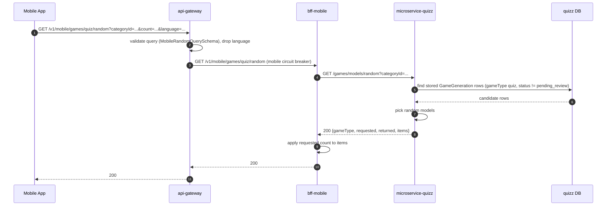
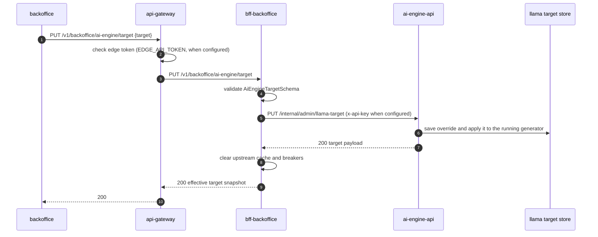
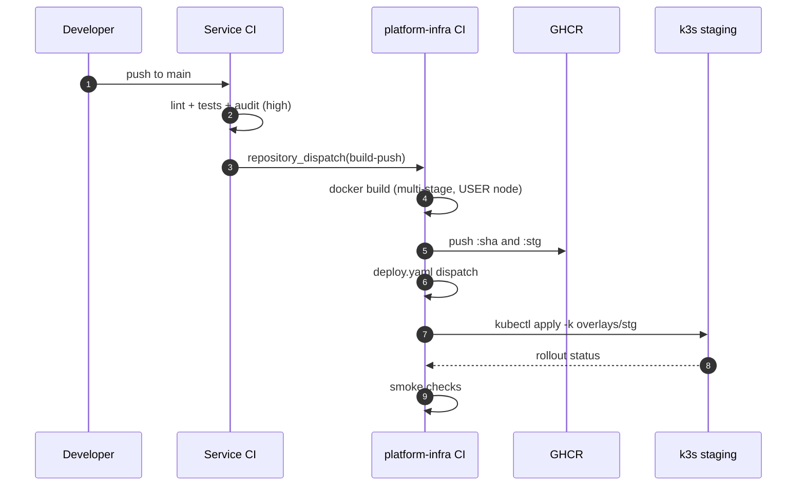
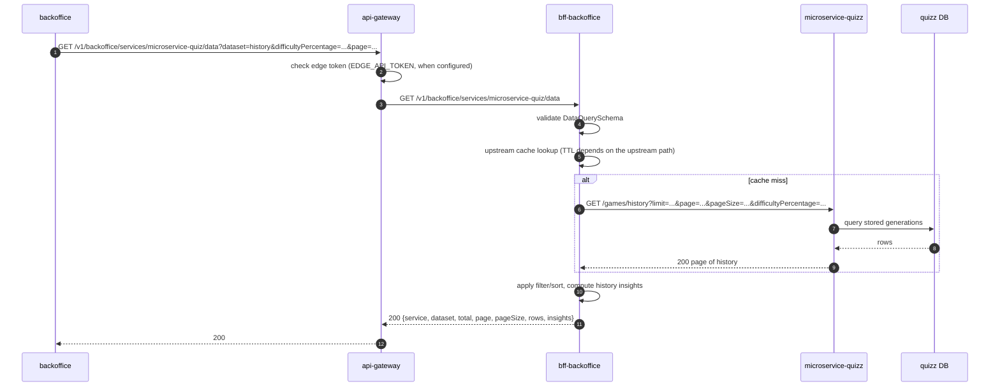
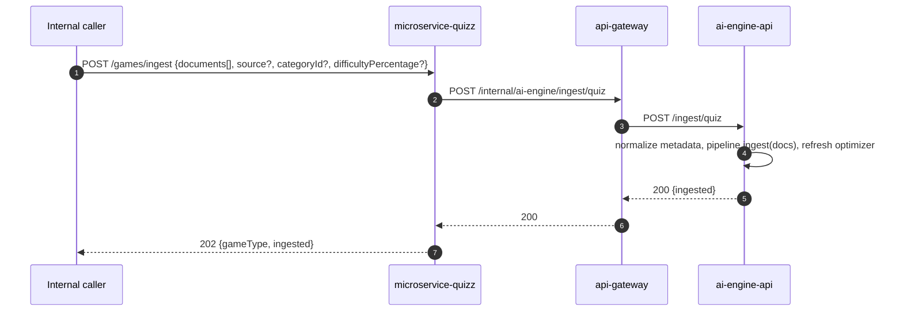
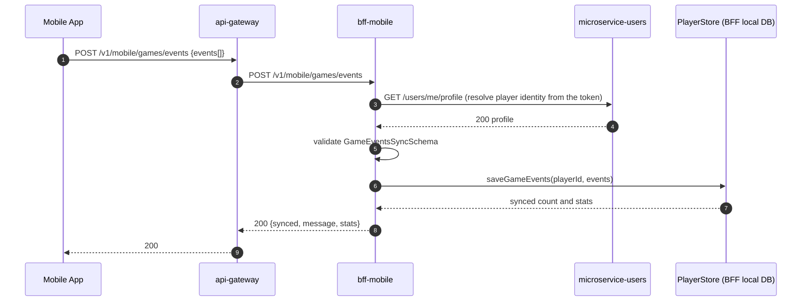
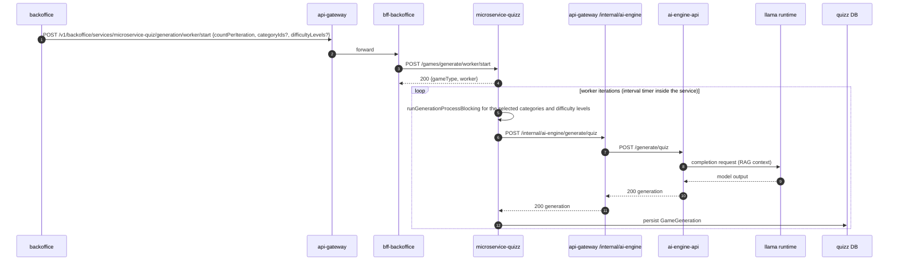

# Key Sequence Flows

Last updated: 2026-11-12.

Sequence diagrams of the most important runtime flows. Each flow lists the use case it satisfies and the failure points to consider.

> **Verification (2026-11-12):** SF-01, SF-02, SF-04, SF-05, SF-06 and SF-07 were rewritten from the route registrations and handlers on `origin/main` of `api-gateway` (`23e067b`), `bff-mobile` (`a3a3fc5`), `bff-backoffice` (`eb4a4a7`), `microservice-quizz`, `microservice-word-pass`, `microservice-users`, `ai-engine` and `shared-sdk-client` (`typescript/src/game-routes.ts`). The earlier version (2026-04-22) described routes that do not exist (`/v1/games/quiz/random`, `/admin/routing/ai-engine`, `/rounds/:id/result`, ...). SF-03 was not re-verified here. Wherever a claim could not be confirmed in code, the flow says so.

## SF-01 Mobile player starts a quiz round (UC-01)

`GET /v1/mobile/games/quiz/random` only reads rows that are already stored. It never calls `ai-engine`: content is produced beforehand by the generation endpoints and the batch worker (SF-07). The word-pass flow is identical with `/v1/mobile/games/wordpass/random` and `microservice-wordpass`.

Failure points:
- Invalid query: 400 from the gateway, never reaches the BFF.
- Nothing stored for the category: the service answers 200 with `returned: 0`; no AI call is made as a fallback.
- Upstream failure or open circuit breaker at the gateway: 503 `Service temporarily unavailable`.

Related: `POST /v1/mobile/games/quiz/generate` (and `/wordpass/generate`) is also served from the inventory. `bff-mobile` calls the same `GET /games/models/random` on the service, returns the first item as `generated`, and answers 502 `No game models available to build a playable game` when there is none. It does not trigger AI generation.

## SF-02 Backoffice operator changes the runtime AI target (UC-09)

There are two independent targets. This flow covers the llama target that `ai-engine-api` uses for generation. The gateway keeps its own ai-engine API/stats target, changed with `PUT /internal/admin/ai-engine/target` (guarded by `API_GATEWAY_ADMIN_TOKEN` when set); it is not changed by this flow.

`DELETE /v1/backoffice/ai-engine/target` follows the same path and resets the override to the environment value.

Failure points:
- Invalid payload or a failed sync with `ai-engine-api`: the BFF answers 400 with the error message.
- Whether the override survives a pod restart depends on where `llama_target_store` writes in the deployment; this was not verified in this review.

## SF-03 CI/CD build and staging deploy (UC-12, UC-13)

> Status: thesis-era flow. On `origin/main` of `platform-infra`, `deploy.yaml` is manual-only (`workflow_dispatch`) because the k3s staging host no longer exists; only the build and push step still runs. The `workflow_run` trigger shown below is currently disabled. The rest of this flow was not re-verified.

Failure points:
- Service CI failure → no dispatch.
- Image digest mismatch → deploy aborts.
- Smoke check fail → rollout marked unhealthy; manual intervention.

## SF-04 Operator inspects stored quiz history with a difficulty filter (UC-06)

Failure points:
- Invalid query: 400 from the BFF with the flattened validation errors.
- Slow or unreachable service: the BFF applies its upstream timeout and circuit breaker; the exact status mapping was not verified here.
- The service key for the quiz service is `microservice-quiz` (not `microservice-quizz`) in the BFF routes.

## SF-05 AI ingest / corpus refresh (UC-11)

There is no BFF route for ingestion. The entry point is the game service, which forwards to `ai-engine` through the gateway (see SF-07 for the same hop used by generation).

Failure points:
- Invalid payload: 400 from the service.
- `ai-engine` unavailable or RAG pipeline not initialised (503 from `ai-engine`): the service answers 502 `Failed to ingest documents into ai-engine RAG`.
- `ai-engine` also exposes the generic `POST /ingest` and `POST /ingest/word-pass`; `POST /ingest/true-false` exists but nothing calls it (see the true-false note below).

## SF-06 Player submits gameplay results (UC-03)

State on `origin/main`: results stay inside `bff-mobile`. `microservice-quizz` has no result endpoint and `microservice-users` is only used by the BFF to identify the player.

Failure points:
- No token or an invalid token: 401 from the BFF.
- `microservice-users` unreachable while resolving the identity: 502 `Failed to resolve player identity`.
- Consequence: mobile results are not written to `microservice-users`, so they do not reach its leaderboard. `microservice-users` has `POST /users/me/games/events` (and the open, unmerged PR AxiomNode/microservice-users#5 proposes `POST /users/me/games/events/batch`), but `bff-mobile` on main does not call either.

## SF-07 Content generation: batch worker and generation processes

Generation is separate from serving. The services call `ai-engine` through the gateway (`AI_ENGINE_BASE_URL=http://api-gateway:7005/internal/ai-engine` in `platform-infra/kubernetes/base/microservice-quizz/api-deployment.yaml`).

Other entry points on the same service: `POST /games/generate` (one item, synchronous), `POST /games/generate/process` (asynchronous, returns a `taskId`; poll `GET /games/generate/process/:taskId`) and `POST /games/generate/process/wait` (blocking). The Backoffice exposes them as `/v1/backoffice/services/:service/generation/process`, `/wait`, `/processes`, `/process/:taskId`.

Notes:
- The k8s base manifest sets `BATCH_GENERATION_ENABLED=false` for `microservice-quizz`; the runtime worker above is controlled through the `/games/generate/worker*` routes.
- The worker is in-process state of each service. There is no queue or message broker.

## True-false is not a game of the platform

`ai-engine` has `POST /generate/true-false` and `POST /ingest/true-false`, but no microservice, BFF route or the mobile app uses them (the mobile `GameType` is QUIZ or WORDPASS only, per the F7 review notes; app code not re-checked here). The gateway does not proxy them either (it only proxies `generate/quiz`, `generate/word-pass`, `ingest/quiz`, `ingest/word-pass`, `catalogs`, `health` and `stats` under `/internal/ai-engine`).

## Related documents

- [Use cases](./use-cases.md)
- [Domain model](./domain-model.md)
- [Target architecture](./target-architecture.md)
- [Runtime routing](../operations/runtime-routing-and-service-targeting.md)
- Route inventory of the gateway and both BFFs (generated from code): `contracts-and-schemas/schemas/route-inventory/edge-routes.md`
