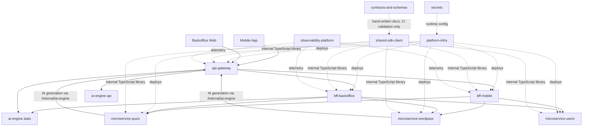

# Current Platform Architecture

Last updated: 2026-11-12.

> **Current vs target (reviewed 2026-11-12 against `origin/main`).** The diagram and the layers below describe the *current* code unless an item is explicitly marked *target* or *not implemented*. Corrections made in this review:
>
> - Quizz and word-pass call `ai-engine` **through the gateway**, not directly: `AI_ENGINE_BASE_URL=http://api-gateway:7005/internal/ai-engine` (`platform-infra/kubernetes/base/microservice-quizz/api-deployment.yaml`). The gateway forwards `/internal/ai-engine/{generate,ingest}/{quiz,word-pass}`, `catalogs`, `health` and `stats` to `ai-engine`.
> - `contracts-and-schemas` is not a build or runtime input of any service: its OpenAPI files are hand-written documentation validated by CI, and there are none for the gateway or the BFFs.
> - `shared-sdk-client` is an internal TypeScript library imported by the gateway, both BFFs and the users, quizz and word-pass services. It does not generate clients.
> - There is no message broker, event bus or Outbox. Asynchronous work is in-process (generation tasks and the runtime worker inside each game service). The event schemas in `contracts-and-schemas/schemas/events/` are *target / not implemented*.
> - `true-false` generation exists only in `ai-engine`; no service, BFF or app uses it.
> - The k3s staging host no longer exists and `platform-infra` `deploy.yaml` is manual-only; the deployment topology below describes the manifests, not a live environment.

## Scope

This document defines the current runtime and delivery architecture for mobile and backoffice channels on top of a microservice platform with AI-assisted generation capabilities and centralized deployment governance.

## Why this matters

- it is the cross-repository architectural reference for platform shape, ownership, and runtime topology
- it captures the difference between deployable topology and effective runtime topology, which is operationally critical in AxiomNode

## Structural view

## Main layers

1. Edge layer: `api-gateway` is the single public ingress and policy boundary.
2. Experience layer: `bff-mobile` and `bff-backoffice` expose channel-shaped contracts.
3. Domain services: `microservice-users`, `microservice-quizz`, `microservice-wordpass`, and optional `ai-engine` endpoints.
4. Data and async layer: service-owned data stores and deferred generation flows. Deferred generation means in-process generation tasks and a runtime worker inside the quizz and word-pass services; there is no broker, queue or event bus (event-driven integration is *target / not implemented*).
5. Platform layer: `platform-infra`, `observability-platform`, `contracts-and-schemas`, `shared-sdk-client`, and `secrets`.

## Context and boundaries

### Repository responsibility boundaries

#### Edge and experience ownership

- `api-gateway` owns the public ingress contract, edge auth, CORS, and internal route fan-out.
- `bff-mobile` owns mobile-facing shaping and shields mobile clients from internal domain-service topology.
- `bff-backoffice` owns backoffice-facing shaping plus runtime routing control APIs used by operators.
- `backoffice` owns the operator UI and must expose the difference between environment defaults and runtime overrides.

#### Domain ownership

- `microservice-users` is the system of record for player identity, profile reads, gameplay events, and leaderboard-oriented metrics.
- `microservice-quizz` owns quiz validation, persistence, retrieval semantics, and its generation request contract toward AI.
- `microservice-wordpass` owns the equivalent behavior for the word-pass domain.
- `ai-engine` owns retrieval-augmented generation, ingest semantics, cache-aware generation behavior, observability of AI requests, and llama runtime integration.

#### Platform ownership

- `contracts-and-schemas` holds the hand-written OpenAPI and JSON Schema documents for the internal services and a generated route inventory for the gateway and BFFs. It is validated in CI but nothing generates code from it, so the code remains the effective source of truth (*target*: contract-first).
- `shared-sdk-client` is an internal TypeScript library (Zod schemas, HTTP proxy helpers, game-service runtime) imported by six services.
- `platform-infra` owns packaging and deployment policy.
- `secrets` owns real runtime secret material and sync rules.
- `observability-platform` owns shared telemetry assets and alerts.

## Key flows

### Runtime topology

#### Default deployable core

The deployable core for staging and production-oriented flows is:

- `api-gateway`
- `bff-mobile`
- `bff-backoffice`
- `backoffice`
- `microservice-users`
- `microservice-quizz`
- `microservice-wordpass`

#### Optional AI topology

`ai-engine` is architecturally part of the platform, but it is no longer assumed to be always in-cluster for staging. Its `true-false` routes are not used by any service, BFF or app; the platform only plays quiz and word-pass.

The current architecture supports two valid runtime modes:

1. split AI runtime: `ai-engine-api` and `ai-engine-stats` in-cluster, llama runtime externalized and selected at runtime
2. full in-cluster AI runtime rendered deliberately for diagnostics, canary validation, or controlled benchmarking
3. fully external workstation-hosted AI runtime reachable through controlled routing when staging recovery requires it

That distinction is important: deployment topology and effective runtime topology are no longer always the same thing.

#### Effective runtime state holders

The current architecture contains a narrow operational state plane outside static manifests:

- `bff-backoffice` persists service-target overrides and shared ai-engine presets
- `api-gateway` persists the live ai-engine API and stats target used by forwarded runtime traffic
- `ai-engine-api` persists the active llama target used by generation requests

These states survive pod recreation through mounted storage and must be documented as part of the effective topology.

### Runtime routing control plane

Backoffice operational tooling now acts as a lightweight runtime control plane for non-static upstream selection.

Current capabilities:

- `bff-backoffice` can persist shared upstream routing overrides
- `api-gateway` can persist the live `ai-engine` target used by the platform
- backoffice operators can select and manage reusable ai-engine destination presets
- routing state survives pod recreation because it is stored on mounted persistent volumes

This control-plane behavior is intentionally narrow in scope: it does not replace GitOps or declarative infrastructure, but it provides pragmatic runtime flexibility for operational AI connectivity.

### Delivery architecture

The delivery architecture is intentionally split:

- service repositories own correctness checks
- `platform-infra` owns container build and deployment policy

This preserves local service autonomy without fragmenting the deployment contract.

## Design constraints

### Architecture principles

- single public ingress
- private internal APIs by default
- versioned and traceable contracts
- observability-first runtime model
- secure-by-default posture
- immutable artifacts for automated deployment
- operational flexibility only where topology genuinely requires it

## Tradeoffs and consequences

### Quality attributes

### Maintainability

- deployment policy is centralized in one repository
- service CI remains close to service code
- shared contracts and SDKs reduce edge/BFF drift
- runtime routing exceptions are documented and persisted, not hidden in ad hoc pod edits

### Traceability

- automatic staging deploys are tied to immutable image SHAs
- service CI, central packaging, and deployment workflows form a clear audit chain

### Operability

- smoke tests and rollout checks are embedded in deployment workflows
- runtime overrides for AI connectivity can be changed without rebuilding or redeploying the entire stack

### Evolvability

- the architecture can support in-cluster or external AI execution
- production can remain stricter than staging without changing the service contract model

### Current architectural constraints

- staging automatic deploys are pinned to immutable short-SHA artifacts, but manual recovery paths can still use mutable environment tags
- runtime overrides introduce a second operational state plane that must be documented and observed
- not every repository in the workspace is part of the GHCR-to-k3s delivery chain
- AI runtime behavior in staging must always be described in terms of both in-cluster services and external llama reachability

### Documentation implications

To keep architecture documentation correct:

- describe both deployed resources and effective live targets
- document where runtime state is persisted and which repository owns that persistence
- keep repository-local docs concrete and central docs cross-repository
- treat AI topology as an operational mode matrix, not as a single fixed shape

## Related documents

- `docs/operations/cicd-workflow-map.md`
- `docs/operations/deployment-strategy.md`
- `docs/operations/runtime-routing-and-service-targeting.md`
